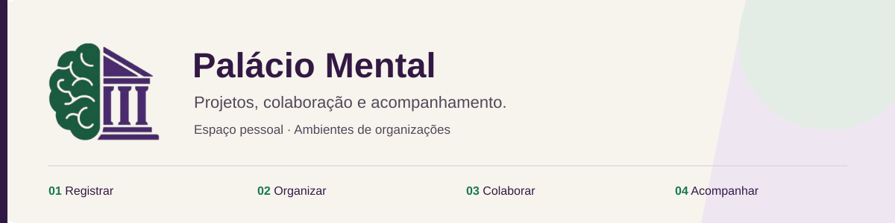

<p align="center">
  
</p>

<p align="center">
  <a href="https://palaciomental.com.br">Aplicação</a> ·
  <a href="postman/README.md">Jornadas de teste</a> ·
  <a href="status_api/README.md">API e monitoramento</a> ·
  <a href="docs/arquitetura-multi-tenant-rls.md">Arquitetura</a>
</p>

O **Palácio Mental** reúne o contexto de um projeto: propósito, referências, equipe e evolução. Pode ser usado em um espaço pessoal ou no ambiente privado de uma organização, com identidade visual e acesso próprios.

| 🗂️ Projetos | 🤝 Colaboração | 🏛️ Organizações |
|---|---|---|
| Registrar ideias, links e marcos de evolução. | Encontrar projetos, comentar e solicitar participação. | Reunir programas, turmas, grupos e atividades. |

No fluxo institucional, o gestor organiza programas e turmas; alunos formam grupos e desenvolvem projetos. Professores orientam as turmas e disponibilizam materiais de apoio.

## Executar

**Requisitos:** Docker com Compose e Python 3 para gerar os segredos locais.

```sh
cp .env.example .env
python3 scripts/configurar_dev.py
docker compose up --build -d
docker compose ps
```

| Acesso local | Endereço |
|---|---|
| Aplicação | http://localhost:8000 |
| API Spring Boot | http://localhost:8080 |
| Swagger | http://localhost:8080/docs |

Para o primeiro acesso administrativo:

```sh
docker compose exec django python manage.py createsuperuser
```

Abra `/admin/` para cadastrar organização, domínio e afiliações. Por exemplo: domínio `camppg.localhost`, acessado em `http://camppg.localhost:8000`. Contas e dados de demonstração não são criados automaticamente.

## Testar

```sh
# Aplicação Django
docker compose exec django python manage.py test

# Contratos de inicialização e automação
docker compose exec django python -m unittest discover -s scripts/tests

# Políticas de isolamento do banco
docker compose exec django python manage.py pm_rls_status --strict
```

O [guia da suíte](plataforma/tests/README.md) reúne comandos por área e critérios para manter os testes enxutos.

As [coleções Postman](postman/README.md) cobrem as jornadas de gestão, projeto e colaboração no CAMPPG. A [API Spring](status_api/README.md) tem instruções próprias de verificação. O CI executa as suítes Django e Spring com PostgreSQL.

## Estrutura

| Caminho | Responsabilidade |
|---|---|
| `plataforma/` · `core/` | Projetos, organizações, permissões e navegação. |
| `templates/` · `static/` | Interface e identidade visual. |
| `setup/` | Configuração e rotas Django. |
| `status_api/` | Guardião de links e monitoramento em Spring Boot / Java 21. |
| `postman/` · `scripts/` · `tools/` | Jornadas HTTP, configuração local e automação. |
| `compose.yaml` · `docker/` | Serviços locais e inicialização do PostgreSQL. |

Django atende os espaços pessoal e institucional. **PostgreSQL com RLS** mantém dados e isolamento; **Redis** auxilia sessões e rankings. O worker comunica os links ao **Guardião**, que verifica disponibilidade e ameaças quando o provedor está configurado.

<details>
<summary>Configuração local e manutenção</summary>

- O script preenche segredos vazios no `.env` e preserva credenciais existentes. Não versione esse arquivo.
- O Compose inicia PostgreSQL, Redis, Django, API, migrations e worker. E-mails vão para o console; mídia fica local. R2, Resend e Safe Browsing são integrações opcionais no desenvolvimento.
- O boot aplica migrations. Após alterações de schema com o servidor já aberto, execute `docker compose exec django python manage.py migrate`.
- `/saude` verifica resposta do Django; `/pronto` verifica banco e migrations.
- Com `DJANGO_DEBUG=True`, `/?tenant=slug` permite selecionar o tenant local. Remova o cookie `pm_dev_tenant` para limpar a seleção.
- `docker compose down` preserva os volumes. A opção `-v` apaga os dados locais.

</details>

Consulte as [regras de acesso e convites](docs/matriz-permissoes-e-convite-multi-tenant.md) antes de alterar permissões. Para contribuir, descreva no PR a mudança de comportamento e a validação realizada.
