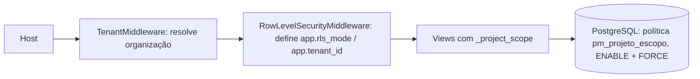

# Arquitetura multi-tenant com RLS mínima (PM-05)

Status: proposta implementada na branch `fix/pm-05-rls-minimo`. Ainda não foi para a main.

## Decisão (ADR resumido)

- Fato: banco compartilhado, `organizacao_id` nas tabelas, tenant resolvido pelo host.
- Decisão: opção A (escopo na aplicação) agora; B (RLS no PostgreSQL) por etapas, começando por `listaEspera_project`; E (banco/schema dedicado) só quando houver gatilho escrito (contrato, volume, exigência regulatória).
- Rejeitadas: C (schema por tenant) e D (banco por tenant). O custo de operação e de migração não se justifica no MVP (Model Council, 2026).

## Camadas

Defesa em profundidade: se a view esquecer o filtro, a política ainda bloqueia o acesso (teste de mutação em `plataforma/tests/seguranca/test_rls_projetos.py`).

## Modos

| Modo | Quando | Linhas visíveis em projetos |
|---|---|---|
| tenant | host de organização | `organizacao_id = app.tenant_id` |
| global | domínio principal | `organizacao_id IS NULL` |
| system | /admin/ para admin interno, fixtures, `system_context()` | todas |
| deny | padrão da conexão (`PM_RLS_DEFAULT_MODE`) | nenhuma |

O contexto é restaurado no `finally`, o que importa porque a conexão é reutilizada (`CONN_MAX_AGE=600`).

## Classificação das tabelas

- Protegida por RLS: `listaEspera_project`.
- Próximas (na ordem): tabelas filhas de projeto, por `EXISTS` no projeto pai; depois `SolicitacaoTurma` e `SolicitacaoGrupo`.
- Globais: usuários, perfis e catálogo.

## Requisitos operacionais

- A role da aplicação não pode ser superusuária nem ter BYPASSRLS. Verifique com `python manage.py pm_rls_status --strict` (a CI já faz isso).
- Comandos de gestão, jobs e streaming rodam fora do middleware e ficam em `deny`. Precisam usar `rls.rls_context(...)` ou `rls.system_context()` de forma explícita.
- Roadmap: role de runtime separada da role dona das migrações (`DATABASE_MIGRATION_URL`).
