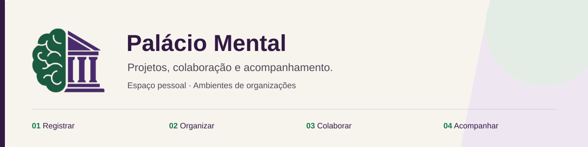

<p align="center">
  
</p>

<p align="center">
  <a href="../README.md">Projeto</a> ·
  <a href="matriz-permissoes-e-convite-multi-tenant.md">Permissões</a> ·
  <a href="../status_api/README.md">API Spring Boot</a>
</p>

## Arquitetura · visão geral

O **Django concentra a aplicação**: interface, contas, projetos e regras institucionais. A API Spring Boot executa o Guardião de links e o monitoramento. Um worker Django conecta os dois serviços.

| 🌐 Entrada | 🧩 Aplicação | 💾 Persistência |
|---|---|---|
| Domínio global ou domínio da organização. | Django renderiza páginas e valida ações; Spring verifica links e disponibilidade. | PostgreSQL mantém os dados; Redis auxilia sessões e rankings. |

## Da navegação ao resultado

| Etapa | O que acontece |
|---|---|
| **1 · Acesso** | O domínio identifica o espaço global ou uma organização. |
| **2 · Autorização** | Django valida sessão, afiliação, papel e acesso ao conteúdo. |
| **3 · Operação** | Formulários e serviços consultam ou gravam no PostgreSQL, com o escopo correto. |
| **4 · Resposta** | Templates, CSS e JavaScript apresentam o resultado; arquivos de mídia usam o storage configurado. |
| **5 · Verificação de links** | Alterações entram na fila; o worker envia ao Spring e traz resultados para a interface. |

A interface é renderizada no servidor. O navegador não acessa diretamente o banco nem recebe o token de comunicação entre Django e Guardião.

## Componentes e infraestrutura

| Componente | Responsabilidade |
|---|---|
| **Django + Gunicorn** | Aplicação web, autenticação, permissões, projetos, programas, turmas, grupos e agenda. |
| **Templates + WhiteNoise** | Páginas HTML e arquivos estáticos da interface. |
| **PostgreSQL** | Dados de negócio, sessões, fila persistente e schema `guardiao`. |
| **Redis** | Cache, apoio às sessões e projeções de ranking; não define autorização. |
| **Worker Django** | Sincronização de links, organizações e notificações com o Spring. Processo separado, sem domínio público. |
| **Spring Boot / Java 21** | Disponibilidade de links, avaliação de ameaças, central de status e incidentes. |
| **Cloudflare R2** | Mídia quando habilitado; desenvolvimento usa armazenamento local. |
| **Resend** | Envio de e-mails quando configurado; desenvolvimento usa console. |
| **Safe Browsing / Discord** | Integrações opcionais de avaliação de ameaças e alertas da equipe. |

O deploy utiliza **Railway** para os serviços e bancos. **Cloudflare** atua no DNS e, nos domínios com proxy habilitado, na entrada HTTPS. O [Compose](../compose.yaml) reproduz os serviços locais; variáveis determinam quais integrações externas ficam ativas.

Esta visão descreve as responsabilidades do software, não um inventário em tempo real de réplicas, custos ou serviços ativos.

## Global e organizações

Uma instalação atende vários ambientes. Cada organização é um **tenant**, identificado pelo hostname cadastrado, com identidade visual e afiliações próprias.

| Espaço global | Espaço institucional |
|---|---|
| Projetos pessoais, com `organizacao_id = NULL`. | Projetos vinculados à organização corrente. |
| Vitrine pessoal/pública conforme visibilidade. | Programas → turmas → grupos → projetos. |
| Contas e perfis compartilhados na plataforma. | Papel e acesso definidos pela afiliação local. |

Compartilhar uma conta não compartilha permissões. O acesso institucional exige organização e afiliação ativas; as [regras por papel](matriz-permissoes-e-convite-multi-tenant.md) continuam valendo dentro do tenant.

<details>
<summary>Isolamento no PostgreSQL · RLS</summary>

Há duas barreiras: filtros e autorização no Django, seguidos de **Row-Level Security**, que restringe linhas no banco para projetos e eventos da agenda.

| Contexto | Projetos | Agenda |
|---|---|---|
| `tenant` | Organização corrente | Organização corrente |
| `global` | Projetos pessoais | Nenhum evento |
| `system` | Operação interna explicitamente autorizada | Operação interna explicitamente autorizada |
| `deny` ou ausente | Nenhuma linha | Nenhuma linha |

O middleware aplica e restaura o contexto. Jobs exigem escopo explícito. RLS não substitui as permissões por autor/destinatário; tabelas filhas ainda dependem dos filtros da aplicação.

A proteção é forçada inclusive para a role proprietária das tabelas, mas superusuários e roles `BYPASSRLS` a ignoram. Verifique a role da aplicação:

```sh
docker compose exec django python manage.py pm_rls_status --strict
```

</details>

<details>
<summary>Falhas, arquivos e tarefas de apoio</summary>

- **Redis:** rankings são revalidados no SQL; sessões têm suporte no banco quando o cache falha. Rebuilds respeitam o escopo global ou institucional.
- **Guardião:** falhas mantêm alterações na fila para retentativa. Ler um projeto não depende de uma nova verificação bem-sucedida. Sem avaliação de ameaça, o resultado é “não verificado”.
- **Mídia:** logo e capa são públicas, normalizadas e recebem novas chaves por upload. Não envie conteúdo privado ao bucket público de identidade.
- **Monitoramento:** Spring consulta páginas e registra incidentes. A sondagem autenticada é um executor opcional, com conta dedicada; seus resultados só entram no painel quando a publicação é configurada.
- **Segredos:** ficam no ambiente de cada serviço. Chamadas protegidas entre Django e Spring usam token compartilhado e HTTPS em produção.

</details>

<details>
<summary>Organização do código e evolução do banco</summary>

| Caminho | Conteúdo |
|---|---|
| `plataforma/` · `core/` | Domínio, regras, views, fila, sessões e rankings. |
| `setup/` | Configuração, rotas e integração dos componentes Django. |
| `templates/` · `static/` | Interface e identidade visual. |
| `status_api/` | Serviço Spring, migrations Flyway e painel de status. |
| `docker/` · `scripts/` | Inicialização local e automação. |
| `postman/` · `.github/workflows/` | Jornadas HTTP e validação contínua. |

Migrations Django e Flyway são independentes. O release da API aplica Flyway antes da troca do serviço; o worker não executa migrations web. Consulte o [guia operacional da API](../status_api/README.md#operar-em-produção).

`plataforma` preserva o app label histórico `listaEspera`, usado nas migrations. Não o renomeie isoladamente. A agenda usa `plataforma_eventocalendario` e não depende do antigo app CAMP.

</details>
