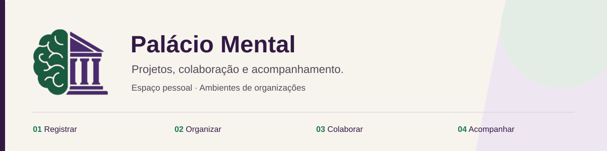

  

  <a href="../README.md">Projeto</a> ·
  <a href="arquitetura-multi-tenant-rls.md">Arquitetura</a> ·
  <a href="../postman/README.md">Jornadas de teste</a>

## Permissões · quem pode fazer o quê

O papel vale **dentro de uma organização**. Para acessar seu ambiente, a pessoa precisa estar autenticada e ter afiliação ativa; a organização também deve estar ativa.

| 🏛️ Proprietário | ⚙️ Gestor | 📚 Professor | 👥 Membro |
|---|---|---|---|
| Administra acessos e papéis. | Organiza programas, turmas e atividades. | Orienta as turmas atribuídas. | Participa das turmas, forma grupos e desenvolve projetos. |

## Administração

**Sim** indica permissão no próprio ambiente, sujeita às regras abaixo.

| Ação | Proprietário | Gestor | Professor | Membro |
|---|---|---|---|---|
| Acessar gestão e editar identidade | Sim | Sim | Não | Não |
| Criar programas e turmas | Sim | Sim | Não | Não |
| Excluir programas e turmas | Com validação de vínculos | Com validação de vínculos | Não | Não |
| Convidar para a organização | Todos os papéis | Professor e membro | Não por este fluxo | Não |
| Alterar papéis | Sim | Não | Não | Não |
| Suspender ou reativar afiliações | Sim | Exceto proprietários | Não | Não |
| Publicar atividades institucionais | Sim | Sim | Não | Não |

Ninguém pode suspender a própria afiliação ou retirar o último proprietário ativo. O Admin técnico do Django tem autorização separada.

## Turmas, grupos e projetos

Aqui, o **vínculo com o conteúdo** também importa. Ser gestor não torna a pessoa autora de um projeto nem participante de um grupo.

| Ação | Quem pode |
|---|---|
| Gerir a turma e decidir solicitações de entrada | Proprietário, gestor ou professor responsável. |
| Manter materiais de apoio | Professor responsável pela turma. |
| Criar grupo | Membro participante da turma ativa, em programa publicado; no máximo um grupo ativo por turma. |
| Convidar para o grupo | Membros ativos do próprio grupo, respeitando a elegibilidade do convidado. |
| Decidir pedidos de entrada no grupo | Representante ativo ou responsável pela gestão da turma. |
| Excluir grupo | Autor, sujeito às validações de vínculos. |
| Criar projeto institucional | Afiliado ativo, com vínculos válidos de programa, turma e grupo. |
| Aceitar colaboração no projeto | Autor; o solicitante deve continuar ativo e afiliado. |
| Comentar ou reconhecer relevância | Pessoa autorizada a acessar o projeto, exceto seu autor. |

A turma define a entrada: **direta, por aprovação ou por convite**. Turmas encerradas não recebem novas participações. O membro só pode vincular o projeto a grupos dos quais participa.

## Convites

**Emissão → envio por e-mail → validação do link → aceite → vínculo.**

O aceite confere domínio, e-mail, validade e disponibilidade da turma ou grupo. O token é aleatório, armazenado como hash e usado uma vez. Um convite de grupo não concede papel institucional privilegiado.

Privacidade e garantias do servidor

- O servidor define a organização de projetos e eventos; valores enviados no formulário não podem trocar esse contexto.
- Projetos pessoais e institucionais têm vitrines separadas. Um link não concede acesso a outra organização.
- Conteúdo privado de outro autor não fica acessível por ter papel de gestão; os relatórios usam agregados.
- O destinatário pode registrar entrega de uma atividade institucional, sem editar ou excluir a atividade. Compromissos pessoais pertencem ao próprio participante.
- Ocultar botões ou falhar o cache não altera permissões. A autorização é validada no servidor e complementada pelo isolamento do banco.

Regras conferidas em [views](../plataforma/views.py), [serviço de convites](../plataforma/services.py) e [testes institucionais](../plataforma/tests/institucional/). Ao mudar uma permissão, atualize também esta matriz e seus testes.
