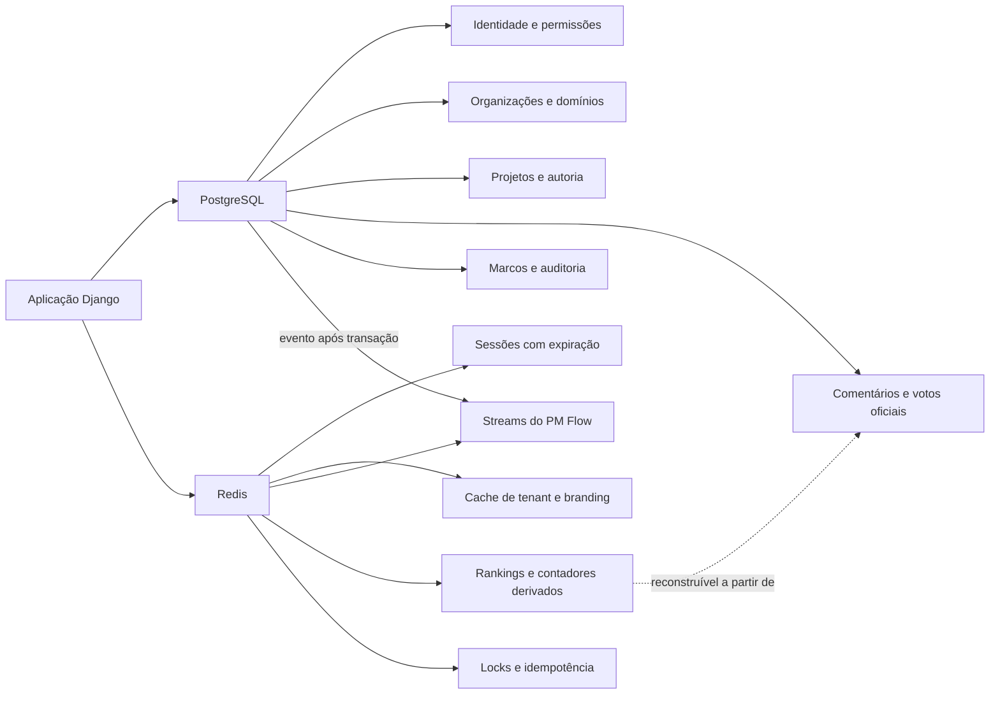

# Palácio Mental — Modelagem Multi-tenant v2

**Status:** revisão conceitual e lógica antes das migrations  
**Repositório analisado:** `DevTroli/palaciomental`  
**Referência da branch:** `main` em `5ec6a9e`  
**Objetivo:** suportar CAMPPG e futuras instituições privadas sem perder os projetos autorais pessoais.

## 1. Decisões fechadas nesta revisão

A arquitetura recomendada fica assim:

- **Banco relacional como fonte oficial:** identidades, organizações, afiliações, permissões, projetos, comentários, votos, marcos, links, solicitações e assinaturas.
- **Redis como camada NoSQL de apoio:** sessões, cache, fila de eventos, deduplicação, notificações transitórias, contadores e rankings derivados.
- **Banco compartilhado com isolamento por linhas:** todas as organizações usam o mesmo banco relacional, mas cada registro institucional carrega `organizacao_id` direta ou indiretamente.
- **Subdomínio institucional como endereço canônico:** `camppg.palaciomental.com.br`.
- **Ambiente institucional fechado:** o tenant exige autenticação e afiliação ativa; o primeiro acesso ocorre por convite emitido por proprietário, gestor ou professor autorizado. Não há cadastro aberto nem navegação anônima do conteúdo institucional.
- **Vitrine institucional isolada:** nesta fase, projetos publicados, programas publicados e estados básicos aparecem somente para afiliados na página interna da própria organização, nunca na vitrine global do Palácio Mental.
- **Projetos autorais e institucionais separados:** dentro do tenant só se criam projetos institucionais, orientados ou autônomos. Projetos pessoais ficam no Meu Espaço, fora da organização.
- **Português no domínio de negócio:** nomes de entidades, campos e enums novos devem ser em português. A tabela técnica do usuário Django pode permanecer compatível com o framework, mas o vocabulário de negócio será português.

## 2. SQL ou NoSQL? A decisão correta por domínio

A pergunta não deve ser “qual banco é mais rápido?”, mas “qual dado precisa de consistência, relacionamento e auditoria; e qual dado é temporário, derivado ou orientado a eventos?”.

### 2.1 Deve permanecer no SQL

#### Login e identidade

Usuários, e-mails, credenciais, perfis e afiliações devem ficar no relacional. Login depende de unicidade, transações, recuperação de conta, auditoria e relações de permissão. Redis pode armazenar sessões e códigos temporários, mas não deve ser a fonte oficial da identidade.

#### Organizações e permissões

`Organizacao`, `DominioOrganizacao`, `MembroOrganizacao`, convites, papéis e status precisam de constraints e joins consistentes. Um erro de autorização entre tenants é um problema de segurança, não uma oportunidade de otimização.

#### Projetos e proteção de autoria

Projeto autoral e projeto institucional precisam de ownership, escopo, visibilidade e histórico confiáveis. O SQL facilita garantir que uma referência exista e que a operação ocorra em transação.

#### Comentários aninhados

Comentários não precisam ir para NoSQL no estágio atual. O modelo atual já usa `comentario_pai_id`, uma lista de adjacência adequada para comentários aninhados. O SQL continua sendo uma opção performática quando existe índice em `(projeto_id, criado_em)` e em `comentario_pai_id`.

Se a árvore crescer muito, há três evoluções possíveis sem abandonar a fonte relacional: adicionar `caminho`, usar materialized path ou criar uma tabela de fechamento. Isso deve ser medido antes de introduzir outra fonte de verdade.

#### Votos oficiais

O voto de relevância deve ficar no SQL para garantir “um voto por usuário por projeto”, revogação e auditoria. Redis pode manter:

```text
ranking:organizacao:{id}:projetos
votos:projeto:{id}:total
```

Esses valores são derivados. Em caso de perda, podem ser reconstruídos por uma consulta SQL. Redis Sorted Sets são adequados para ordenar membros por pontuação e Streams são adequados para registrar eventos em ordem. [4]

### 2.2 Deve ir para Redis/NoSQL

#### Sessões

Sessões de login podem usar Redis com expiração automática. A conta e seus vínculos continuam no SQL.

#### Cache de tenant

O resultado de `hostname -> organizacao_id`, branding e configurações de navegação pode ser armazenado em Redis com TTL e invalidação quando a organização for alterada.

#### PM Flow

Eventos como “link adicionado”, “projeto publicado” ou “novo marco criado” podem ser publicados em Redis Streams para processamento assíncrono. O evento de domínio nasce após a transação SQL; Redis coordena o trabalho, mas não substitui o registro oficial.

#### Contadores e rankings

Contagem de votos, acessos, notificações não lidas e projetos em destaque pode ser mantida como projeção derivada. A regra é: **Redis acelera a leitura; SQL explica a verdade**.

#### Dados transitórios

Rate limits, locks distribuídos, tokens de curta duração e jobs pendentes são bons candidatos para Redis por terem expiração ou poderem ser refeitos.

### 2.3 Não mover agora para Redis

Não mover comentários, votos, memberships, permissões ou projetos para Redis apenas porque o requisito pede um banco NoSQL. Isso aumentaria a duplicação, dificultaria consultas administrativas, complicaria backup e criaria conflitos entre estado relacional e estado derivado.

O requisito de Relacional + NoSQL fica tecnicamente atendido de maneira mais saudável com PostgreSQL para o domínio e Redis para cache, eventos e projeções operacionais.

## 3. Shared database + isolated rows é a opção mais modular?

**Para o momento atual, sim.** É a opção mais modular e manutenível, desde que o isolamento seja uma regra arquitetural obrigatória e não apenas um filtro repetido manualmente.

Vantagens:

- uma única cadeia de migrations;
- backup e restauração centralizados;
- consultas administrativas e relatórios mais simples;
- custo menor para CAMPPG e primeiros tenants;
- criação de novas organizações sem provisionar banco novo;
- evolução uniforme do produto;
- possibilidade futura de particionar tabelas grandes sem trocar o domínio.

Riscos:

- um queryset sem filtro pode vazar dados entre organizações;
- índices precisam começar por `organizacao_id` em tabelas de alto volume;
- relatórios globais precisam distinguir pessoal, institucional e organização;
- scripts administrativos devem exigir escopo explícito.

A mitigação é combinar:

1. middleware de resolução do tenant;
2. `QuerySet`/services escopados;
3. policies de acesso;
4. testes automatizados de vazamento entre tenants;
5. constraints e índices compostos;
6. PostgreSQL Row-Level Security como defesa adicional quando o ambiente de produção estiver estabilizado.

PostgreSQL permite políticas por linha para selecionar, inserir, atualizar e excluir registros, com comportamento de negação padrão quando o RLS está ativo sem políticas aplicáveis. [3] Ainda assim, RLS não substitui a autorização da aplicação e não deve ser a primeira camada implementada neste projeto.

## 4. Subdomínio com Railway, Cloudflare e Registro.br

A arquitetura é viável e relativamente tranquila para várias instituições porque o DNS não precisa ser alterado a cada novo tenant.

### Configuração recomendada

No Cloudflare, criar um registro wildcard para apontar os subdomínios ao serviço da Railway:

```text
Tipo: CNAME
Nome: *
Destino: alvo fornecido pela Railway
Proxy: conforme o fluxo de verificação e SSL da Railway
```

Na Railway, cadastrar o domínio wildcard `*.palaciomental.com.br`. A Railway documenta suporte a wildcard domains, exige registros CNAME e TXT para verificação e provisiona SSL automaticamente após a configuração correta. [1]

O Cloudflare suporta registros wildcard e permite que centenas ou milhares de subdomínios apontem para o mesmo recurso. Registros específicos têm precedência sobre o wildcard, o que permite reservar nomes como `www`, `api`, `status` e `admin`. [2]

Como o DNS está no Cloudflare, o Registro.br funciona como registrador/delegador: o domínio deve continuar usando os nameservers do Cloudflare. A configuração completa do Cloudflare exige trocar os nameservers no registrador e manter DNSSEC coordenado durante a migração. [3]

### Fluxo de criação de uma instituição

1. Criar `Organizacao` no painel administrativo.
2. Validar e reservar `slug = camppg`.
3. Criar `DominioOrganizacao` com `camppg.palaciomental.com.br`.
4. O wildcard DNS já direciona o host para Railway.
5. O middleware consulta o host na tabela e resolve CAMPPG.
6. A aplicação exibe branding e conteúdo institucional da organização.
7. Nenhuma alteração individual no Registro.br é necessária.

### Cuidados operacionais

- manter lista de slugs reservados (`www`, `api`, `admin`, `status`, `app`);
- normalizar hostname sem protocolo, porta ou barra final;
- negar host desconhecido em vez de cair silenciosamente em um tenant;
- habilitar `ALLOWED_HOSTS` para o domínio base e wildcard conforme o ambiente;
- manter SSL/TLS em modo compatível com a configuração de proxy do Cloudflare;
- testar `camppg.palaciomental.com.br`, host desconhecido e domínio principal separadamente;
- deixar domínio personalizado (`campus.camppg.edu.br`) para uma segunda fase, usando verificação de propriedade.

A Railway informa limites de domínios customizados por plano. Para subdomínios wildcard, o custo operacional tende a ser melhor do que cadastrar centenas de domínios isolados, mas o plano da Railway precisa ser conferido antes do rollout comercial. [1]

## 5. Separação de projetos pessoais e institucionais

A regra de produto deve ser explícita:

```text
Projeto pessoal:
- organizacao_id = nulo
- autor controla o projeto
- pode aparecer na vitrine global, se público
- é criado e administrado pelo Meu Espaço, fora do tenant

Projeto institucional:
- organizacao_id preenchido
- autor continua sendo o proprietário original do feito
- organização controla o ambiente e as políticas
- acesso exige afiliação ativa ao tenant
- publicação fica restrita ao catálogo interno da organização nesta fase
- projeto não aparece na vitrine global
```

A organização não deve apagar ou reatribuir silenciosamente o trabalho autoral. Ela administra o ambiente institucional, os papéis e as regras de publicação; o autor original permanece registrado. A exclusão deve exigir policy própria e auditoria.

## 6. Modelagem conceitual revisada

### Núcleo de identidade

- Usuário
- Perfil do membro
- Plano
- Assinatura individual

### Núcleo institucional

- Organização
- Identidade da organização
- Domínio da organização
- Membro da organização
- Convite da organização
- Programa institucional
- Turma ou grupo institucional
- Participação em turma ou grupo
- Vínculo entre turma ou grupo e projeto
- Assinatura institucional

### Núcleo de produção

- Projeto
- Membro do projeto
- Link do projeto
- Comentário do projeto
- Voto do projeto
- Marco do projeto
- Evento do projeto
- Solicitação de colaboração

### Núcleo de comunicação

- Notificação

A vitrine não precisa de uma tabela própria nesta primeira versão. Ela é uma consulta de projetos publicados filtrada pelo contexto do tenant e pela afiliação ativa do usuário. Uma futura coleção editorial pode nascer quando houver curadoria, ordenação manual ou destaque institucional que não caiba apenas no projeto.

## 7. Modelo lógico em português

### Organização

`Organizacao` é o tenant. Possui slug, nome, status e datas. `IdentidadeOrganizacao` guarda logo, cores, nome de exibição e configurações visuais. `DominioOrganizacao` relaciona hosts à organização e controla qual endereço é principal.

### Membro da organização

`MembroOrganizacao` representa tecnicamente a afiliação entre `Usuario` e `Organizacao`. O papel é institucional e não deve ser confundido com o papel dentro de um projeto. A afiliação ativa é obrigatória para acessar o tenant.

Papéis iniciais:

- `proprietario`: responsável máximo pelo tenant;
- `gestor`: administração operacional;
- `professor`: orientação, acompanhamento, feedback e, quando autorizado, convite de participantes;
- `membro`: participante institucional;
- `leitor`: acesso somente leitura.

### Projeto

`Projeto` possui `proprietario_id` obrigatório e `organizacao_id` opcional. Essa combinação preserva autoria e separa escopo. O mesmo usuário pode ter projetos pessoais e institucionais sem misturar vitrines.

Um projeto institucional pode ser associado opcionalmente a uma `TurmaGrupo`. Assim, o modelo suporta três situações sem criar exceções artificiais:

- projeto autoral pessoal, sem organização;
- projeto institucional autônomo, dentro da organização, mas sem turma;
- projeto orientado, associado a uma turma ou grupo de um programa.

`ProgramaInstitucional` representa uma disciplina, programa, edital, laboratório ou iniciativa interna. `TurmaGrupo` representa uma coorte, grupo de trabalho ou equipe dentro desse programa. A orientação do professor é uma relação de participação com papel, não uma propriedade obrigatória do projeto.

### Comentários

`ComentarioProjeto` mantém `comentario_pai_id` opcional para respostas aninhadas. O acesso sempre deriva do projeto. Para leitura, usar índices por projeto e pai; para escrita, transação SQL.

### Votos

`VotoProjeto` mantém a restrição única `(projeto_id, usuario_id)`. O ranking em Redis é uma projeção, não o registro oficial.

### Eventos e marcos

`EventoProjeto` é o registro técnico das ações. `MarcoProjeto` é a síntese legível. Isso impede que cada alteração trivial apareça como milestone e permite ao PM Flow consumir eventos.

## 8. DER em português

O DER abaixo está organizado por semântica: identidade, organização, produção, comunicação e produto. As entidades com `organizacao_id` nulo ou indireto preservam o modo pessoal do Palácio Mental.

```mermaid
erDiagram
    USUARIO ||--o| PERFIL_MEMBRO : possui
    USUARIO ||--o{ MEMBRO_ORGANIZACAO : participa
    ORGANIZACAO ||--o{ MEMBRO_ORGANIZACAO : possui
    ORGANIZACAO ||--o{ DOMINIO_ORGANIZACAO : publica_em
    ORGANIZACAO ||--|| IDENTIDADE_ORGANIZACAO : personaliza
    ORGANIZACAO ||--o{ CONVITE_ORGANIZACAO : emite
    USUARIO ||--o{ CONVITE_ORGANIZACAO : cria

    PLANO ||--o{ ASSINATURA_USUARIO : oferece
    USUARIO ||--o{ ASSINATURA_USUARIO : contrata
    PLANO ||--o{ ASSINATURA_ORGANIZACAO : oferece
    ORGANIZACAO ||--o{ ASSINATURA_ORGANIZACAO : contrata

    USUARIO ||--o{ PROJETO : autoria
    ORGANIZACAO o|--o{ PROJETO : enquadra
    PROJETO ||--o{ MEMBRO_PROJETO : inclui
    USUARIO ||--o{ MEMBRO_PROJETO : colabora
    PROJETO ||--o{ LINK_PROJETO : reune
    PROJETO ||--o{ COMENTARIO_PROJETO : recebe
    USUARIO ||--o{ COMENTARIO_PROJETO : escreve
    COMENTARIO_PROJETO o|--o{ COMENTARIO_PROJETO : responde
    PROJETO ||--o{ VOTO_PROJETO : recebe
    USUARIO ||--o{ VOTO_PROJETO : registra
    PROJETO ||--o{ MARCO_PROJETO : sintetiza
    USUARIO ||--o{ MARCO_PROJETO : autoriza
    PROJETO ||--o{ EVENTO_PROJETO : registra
    USUARIO o|--o{ EVENTO_PROJETO : provoca
    PROJETO ||--o{ SOLICITACAO_COLABORACAO : recebe
    USUARIO ||--o{ SOLICITACAO_COLABORACAO : solicita
    USUARIO ||--o{ NOTIFICACAO : recebe
    ORGANIZACAO o|--o{ NOTIFICACAO : contextualiza

    USUARIO {
        uuid id PK
        string nome_usuario
        string email
        boolean ativo
    }
    PERFIL_MEMBRO {
        bigint id PK
        uuid usuario_id FK
        string biografia
        datetime criado_em
        datetime atualizado_em
    }
    ORGANIZACAO {
        uuid id PK
        string slug
        string nome
        string nome_legal
        string status
        datetime criado_em
        datetime atualizado_em
    }
    IDENTIDADE_ORGANIZACAO {
        uuid id PK
        uuid organizacao_id FK
        string nome_exibicao
        string logo
        string cor_primaria
        string cor_destaque
        string cor_fundo
    }
    DOMINIO_ORGANIZACAO {
        uuid id PK
        uuid organizacao_id FK
        string hostname
        string tipo
        boolean principal
        string status_verificacao
        datetime verificado_em
    }
    MEMBRO_ORGANIZACAO {
        uuid id PK
        uuid organizacao_id FK
        uuid usuario_id FK
        string papel
        string status
        datetime entrou_em
    }
    CONVITE_ORGANIZACAO {
        uuid id PK
        uuid organizacao_id FK
        uuid convidado_por_id FK
        string email
        string papel
        string hash_token
        datetime expira_em
        datetime aceito_em
    }
    PLANO {
        uuid id PK
        string codigo
        string nome
        string tipo
        string status
    }
    ASSINATURA_USUARIO {
        uuid id PK
        uuid usuario_id FK
        uuid plano_id FK
        string status
        datetime inicia_em
        datetime termina_em
    }
    ASSINATURA_ORGANIZACAO {
        uuid id PK
        uuid organizacao_id FK
        uuid plano_id FK
        string status
        datetime inicia_em
        datetime termina_em
    }
    PROJETO {
        bigint id PK
        uuid proprietario_id FK
        uuid organizacao_id FK
        string titulo
        string direcao
        string status
        string visibilidade
        uuid token_acesso
        datetime atualizado_em
    }
    MEMBRO_PROJETO {
        bigint id PK
        bigint projeto_id FK
        uuid usuario_id FK
        string papel
        boolean pode_gerir_marcos
        string status
    }
    LINK_PROJETO {
        bigint id PK
        bigint projeto_id FK
        string rotulo
        string url
        datetime criado_em
    }
    COMENTARIO_PROJETO {
        bigint id PK
        bigint projeto_id FK
        uuid autor_id FK
        bigint comentario_pai_id FK
        string conteudo
        datetime criado_em
    }
    VOTO_PROJETO {
        bigint id PK
        bigint projeto_id FK
        uuid usuario_id FK
        datetime criado_em
    }
    MARCO_PROJETO {
        bigint id PK
        bigint projeto_id FK
        uuid autor_id FK
        string tipo
        string titulo
        string descricao
        datetime criado_em
    }
    EVENTO_PROJETO {
        uuid id PK
        bigint projeto_id FK
        uuid ator_id FK
        string tipo_evento
        string origem
        json dados
        datetime ocorrido_em
    }
    SOLICITACAO_COLABORACAO {
        bigint id PK
        bigint projeto_id FK
        uuid solicitante_id FK
        string mensagem
        string status
        datetime decidida_em
    }
    NOTIFICACAO {
        bigint id PK
        uuid destinatario_id FK
        uuid organizacao_id FK
        string tipo
        string mensagem
        datetime lida_em
    }
```



## 9. Arquitetura SQL + Redis



Redis é um servidor de estruturas de dados, com hashes, sets, sorted sets e streams adequados para cache, filas, processamento de eventos e rankings. [4]

## 10. Dicionário das entidades novas

| Entidade | Chave e campos essenciais | Finalidade | Persistência |
|---|---|---|---|
| `Organizacao` | `id`, `slug`, `nome`, `nome_legal`, `status`, datas | Tenant institucional e unidade de governança | PostgreSQL |
| `IdentidadeOrganizacao` | `organizacao_id`, logo, cores, nome de exibição | White-label e identidade visual | PostgreSQL + cache Redis |
| `DominioOrganizacao` | `organizacao_id`, `hostname`, tipo, principal, verificação | Resolver subdomínio/domínio para tenant | PostgreSQL + cache Redis |
| `MembroOrganizacao` | `organizacao_id`, `usuario_id`, papel, status | Permissões institucionais | PostgreSQL |
| `ConviteOrganizacao` | organização, e-mail, papel, hash, validade | Entrada controlada no tenant | PostgreSQL; token transitório pode usar Redis |
| `Plano` | código, nome, tipo, status | Catálogo Free, Pro e Institucional | PostgreSQL |
| `AssinaturaUsuario` | usuário, plano, status, período | Plano individual | PostgreSQL |
| `AssinaturaOrganizacao` | organização, plano, status, período | Plano institucional | PostgreSQL |
| `ProgramaInstitucional` | organização, nome, tipo, período, responsável | Disciplina, programa, edital, laboratório ou iniciativa interna | PostgreSQL |
| `TurmaGrupo` | programa, nome, código, período, status | Turma, grupo de pesquisa, equipe ou coorte | PostgreSQL |
| `MembroTurmaGrupo` | turma/grupo, usuário, papel, status | Professor, gestão ou participante; a orientação voluntária fica no papel de professor | PostgreSQL |
| `ProjetoTurmaGrupo` | projeto, turma/grupo, tipo de vínculo | Liga projeto orientado ou autônomo a um contexto institucional | PostgreSQL |
| `EventoProjeto` | projeto, ator, tipo, origem, dados, data | Auditoria e entrada do PM Flow/VCS | PostgreSQL; distribuição por Redis Streams |
| `Notificacao` | destinatário, organização, tipo, mensagem, leitura | Comunicação persistente do produto | PostgreSQL; badge pode ser cache Redis |

## 11. Tradução do modelo atual para o vocabulário de negócio

| Model atual | Nome conceitual em português | Observação |
|---|---|---|
| `WaitlistEntry` | `EntradaListaEspera` | Legado; fora do tenant institucional. |
| `MemberProfile` | `PerfilMembro` | Perfil público do usuário. |
| `Project` | `Projeto` | Adicionar `organizacao_id` opcional. |
| `ProjectLink` | `LinkProjeto` | Hub de referências. |
| `ProjectMember` | `MembroProjeto` | Papel dentro do feito. |
| `ProjectComment` | `ComentarioProjeto` | Comentário aninhado com pai opcional. |
| `ProjectVote` | `VotoProjeto` | Fonte oficial de relevância. |
| `ProjectMilestone` | `MarcoProjeto` | Síntese legível de avanço. |
| `CollaborationRequest` | `SolicitacaoColaboracao` | Solicitação pendente ou resolvida. |
| `Notification` | `Notificacao` | Comunicação persistente. |

A mudança de nomes deve ser feita em uma migração planejada, não por substituição direta em produção. Primeiro traduzimos o vocabulário de domínio em código, forms, templates, admin e documentação; depois avaliamos `db_table` e nomes físicos de colunas para evitar uma migração de dados desnecessária.

## 12. Próximo passo antes do código

A modelagem está pronta para uma revisão de produto. Antes das migrations, precisamos apenas validar:

1. os nomes dos papéis institucionais;
2. se `leitor` é suficiente ou se haverá papel específico de gestor de turma;
3. quais campos visuais CAMPPG precisa controlar no primeiro piloto;
4. se a assinatura institucional já entra na primeira migration ou fica como desenho reservado;
5. qual volume esperado de comentários, votos e eventos para definir os primeiros índices.

Minha recomendação atual é não mover comentários ou votos oficiais para NoSQL. O desenho mais robusto é relacional para verdade e autorização, Redis para velocidade e processamento assíncrono.

## Referências

[1]: https://docs.railway.com/networking/domains/working-with-domains "Railway Working with Domains"
[2]: https://developers.cloudflare.com/dns/manage-dns-records/reference/wildcard-dns-records/ "Cloudflare Wildcard DNS Records"
[3]: https://developers.cloudflare.com/dns/zone-setups/full-setup/setup/ "Cloudflare Full Setup"
[4]: https://redis.io/docs/latest/develop/data-types/ "Redis Data Types"
[5]: https://www.postgresql.org/docs/current/ddl-rowsecurity.html "PostgreSQL Row Security Policies"
