# Palácio Mental — Modelagem de dados para Multi-tenant

**Status:** proposta para alinhamento antes da implementação
**Base analisada:** `main` em `5ec6a9e` — merge do PR #55
**Escopo:** modelagem conceitual, modelagem lógica, decisões de tenancy, isolamento, DER e dicionário de dados inicial.

## 1. Decisão arquitetural recomendada

A recomendação é adotar **shared database + isolated rows** como estratégia de persistência. Todas as organizações compartilharão o mesmo banco relacional, mas os registros institucionais terão uma referência explícita para a organização (`organization_id`). O isolamento será aplicado em quatro camadas:

1. **Resolução do tenant:** a requisição identifica a organização por domínio ou subdomínio.
2. **Autorização de aplicação:** views, services e querysets filtram pela organização resolvida e pela membership do usuário.
3. **Restrições do banco:** chaves estrangeiras, unicidade composta e índices impedem inconsistências estruturais.
4. **Defesa adicional no PostgreSQL:** quando a aplicação migrar para PostgreSQL em produção, Row-Level Security poderá ser habilitado em tabelas críticas como segunda barreira.

Esse modelo preserva o custo operacional baixo, permite consultas e migrações centralizadas e é compatível com o estágio atual do projeto. Não recomendo começar com um banco ou schema separado por organização: isso aumenta a complexidade de migrations, observabilidade, backup, provisionamento e suporte antes de existir volume que justifique essa separação.

## 2. Subdomínio, caminho ou domínio personalizado?

### Escolha recomendada

O **subdomínio deve ser o endereço canônico institucional**:

```text
camppg.palaciomental.com.br
```

Ele expressa melhor que a instituição possui um ambiente próprio, facilita white-label, separa a navegação institucional da marca pública do Palácio Mental e permite evoluir futuramente para um domínio personalizado.

O tenant não deve ser inferido diretamente de uma string fixa no código. O host recebido precisa ser resolvido contra uma tabela de domínios cadastrados:

```text
OrganizationDomain
- camppg.palaciomental.com.br -> CAMPPG
- projetos.camppg.edu.br     -> CAMPPG, no futuro
```

O Django expõe o host da requisição por `request.get_host()`, respeitando `ALLOWED_HOSTS`; portanto, o domínio é uma entrada controlada da aplicação, não uma autorização por si só. [1]

### Caminho como fallback operacional

Durante desenvolvimento, testes e primeiro rollout, manter um fallback de caminho pode ser útil:

```text
/                    -> experiência pública
/o/camppg/              -> ambiente institucional explícito
```

Esse caminho não precisa ser o endereço comercial definitivo. Ele reduz a dependência inicial de DNS e wildcard SSL e facilita testes locais. Em produção, o subdomínio deve ser o endereço principal e o caminho pode redirecionar para ele.

### Domínio personalizado

Domínio personalizado deve ser tratado como uma linha adicional em `OrganizationDomain`, com estado de verificação. Não deve exigir nova model ou novo fluxo de negócio:

```text
campus.camppg.edu.br -> CAMPPG
```

A tabela precisa guardar `is_primary`, `verified_at`, `verification_token` e um status de verificação. A validação de DNS, SSL e roteamento fica fora do modelo de negócio.

## 3. O que é o Global Context e por que ele importa?

Neste projeto, “Global Context” não significa uma variável global mutável. Isso seria perigoso em aplicações web concorrentes. O conceito correto é um **contexto de requisição**:

```python
request.organization
request.organization_membership
request.tenant_source
```

O middleware resolve a organização uma única vez no começo da requisição. Depois, views, services, templates e auditoria podem consultar o mesmo objeto sem repetir a lógica de interpretar host, slug e permissões.

A relevância é principalmente de consistência e segurança:

- evita que cada view implemente sua própria regra de identificação;
- torna explícito qual tenant está ativo na requisição;
- permite filtrar projetos, notificações e membros sempre pelo mesmo escopo;
- facilita adicionar branding, plano e configurações institucionais ao template;
- cria um ponto claro para bloquear host desconhecido, tenant suspenso ou usuário sem membership.

O contexto não substitui autorização. Toda operação sensível ainda deve verificar ownership, role e escopo. O middleware resolve “qual organização está sendo acessada”; o serviço de autorização decide “o que este usuário pode fazer nela”. O Django documenta middleware como camada global de processamento de request/response, e a ordem dos middlewares importa. [2]

## 4. Estado atual do domínio

A branch principal atual contém estas entidades:

- `MemberProfile`: extensão pública do usuário global;
- `Project`: projeto com `owner`, título, direção, status, visibilidade, categoria, tags e colaboração;
- `ProjectLink`: hub de links do projeto;
- `ProjectMember`: membros e papel no projeto;
- `ProjectComment`: comentários e respostas;
- `ProjectVote`: voto único por usuário/projeto;
- `ProjectMilestone`: marcos do projeto;
- `CollaborationRequest`: solicitação de colaboração;
- `Notification`: notificações do usuário.

Hoje não existem `Organization`, `OrganizationMembership`, `OrganizationDomain`, `Plan`, `Subscription` nem uma coluna de escopo institucional em `Project`. O `Project.owner` é global e a autorização ainda é principalmente baseada no dono, membros e visibilidade.

## 5. Modelagem conceitual

O domínio passa a ter quatro núcleos:

### Identidade e acesso

Um usuário pode participar de zero ou mais organizações. A relação não deve ser um campo `organization` direto no usuário, porque o mesmo usuário pode ser professor em uma organização e autor ou gestor em outra.

### Organização e ambiente

Uma organização representa uma ONG, empresa, escola, faculdade, programa ou outro ambiente institucional. Ela possui identidade, estado operacional, plano e um ou mais domínios.

### Projetos e produção

Projetos podem ser pessoais ou institucionais. Um projeto pessoal possui `organization_id = NULL`. Um projeto institucional pertence a exatamente uma organização. Seus links, membros, comentários, votos, milestones e solicitações herdam o escopo por meio do projeto.

### Produto e sustentabilidade

Planos e assinaturas devem ser modelados separadamente do conteúdo. A assinatura da organização controla recursos institucionais; a assinatura do usuário controla recursos individuais. O projeto não deve conhecer regra de cobrança diretamente.

## 6. Modelagem lógica proposta

### Novas entidades principais

#### `Organization`

Representa o tenant institucional. Campos essenciais:

- `id` UUID;
- `slug` único e estável;
- `name` nome público;
- `legal_name` opcional;
- `status` (`active`, `suspended`, `archived`);
- `plan_code` ou relação com assinatura;
- `created_at`, `updated_at`.

#### `OrganizationBranding`

Mantém o white-label fora da tabela principal:

- `organization_id` único;
- `logo`, quando houver storage configurado;
- `primary_color`, `accent_color`, `background_color`;
- `font_family` ou preset controlado;
- `custom_css_enabled` apenas se houver sanitização forte;
- `updated_at`.

A separação impede que a configuração visual cresça dentro de `Organization` e permite cache independente.

#### `OrganizationDomain`

Relaciona um host a uma organização:

- `organization_id`;
- `hostname` normalizado e único;
- `kind` (`subdomain`, `custom`);
- `is_primary`;
- `verification_status`;
- `verification_token`;
- `verified_at`.

#### `OrganizationMembership`

Relaciona usuário e organização:

- `organization_id`;
- `user_id`;
- `role` (`owner`, `admin`, `teacher`, `mentor`, `member`, `viewer`);
- `status` (`invited`, `active`, `suspended`, `removed`);
- `joined_at`, `updated_at`;
- `invited_by_id` opcional.

Regra estrutural: apenas uma membership ativa por par usuário/organização. A organização precisa ter pelo menos um owner ativo; essa regra deve ser garantida por service transacional, não apenas por formulário.

#### `OrganizationInvitation`

Convite pendente para usuários que ainda podem não existir:

- `organization_id`;
- `email` normalizado;
- `role`;
- `token_hash`;
- `invited_by_id`;
- `expires_at`, `accepted_at`, `revoked_at`.

### Alterações nas entidades existentes

#### `Project`

Adicionar:

- `organization_id` nullable para preservar projetos pessoais;
- `scope` (`personal`, `organization`) ou uma regra equivalente claramente documentada;
- índice composto `(organization_id, visibility, status, updated_at)`;
- unicidade de título case-insensitive por proprietário dentro do escopo adequado.

Recomendação para a primeira migração: manter `organization_id = NULL` em todos os projetos atuais. Novos projetos institucionais serão criados somente por service que exige membership ativa. Não fazer backfill artificial para uma organização padrão.

#### `ProjectMember`

Adicionar, se necessário, `invited_by_id`, `status` e timestamps de atualização. A membership de projeto não deve conceder acesso a um projeto institucional se o usuário não tiver membership válida na organização.

#### `Notification`

Adicionar `organization_id` nullable apenas se a notificação precisar ser filtrada diretamente por tenant. Caso contrário, ela pode continuar derivando o tenant do objeto referenciado. Para notificações multi-tenant, é preferível guardar o escopo explicitamente para evitar ambiguidades quando a mesma pessoa participa de várias organizações.

#### `ProjectMilestone`

O modelo atual representa marcos manuais. Para PM Flow e PM VCS, a evolução recomendada é adicionar uma entidade de eventos:

- `ProjectEvent` registra ação técnica ou de domínio;
- `ProjectMilestone` é criado a partir de eventos relevantes, não de cada alteração;
- `actor_id`, `event_type`, `payload_json`, `occurred_at` e `source` formam o histórico auditável.

Isso mantém milestone como síntese legível, enquanto o evento preserva o fato técnico.

## 7. DER — proposta visual

O diagrama abaixo representa a primeira versão lógica. Ele não inclui tabelas internas do Django (`auth_user`, sessões e migrations) nem detalhes futuros de faturamento que não precisam bloquear a arquitetura multi-tenant.

```mermaid
erDiagram
    USER ||--o{ ORGANIZATION_MEMBERSHIP : participates
    ORGANIZATION ||--o{ ORGANIZATION_MEMBERSHIP : has
    ORGANIZATION ||--o{ ORGANIZATION_DOMAIN : owns
    ORGANIZATION ||--|| ORGANIZATION_BRANDING : configures
    USER ||--o{ ORGANIZATION_MEMBERSHIP : invited_as
    ORGANIZATION ||--o{ ORGANIZATION_INVITATION : sends
    USER ||--o{ ORGANIZATION_INVITATION : creates

    USER ||--o| MEMBER_PROFILE : owns
    USER ||--o{ PROJECT : owns
    ORGANIZATION o|--o{ PROJECT : scopes
    PROJECT ||--o{ PROJECT_LINK : gathers
    PROJECT ||--o{ PROJECT_MEMBER : includes
    USER ||--o{ PROJECT_MEMBER : joins
    PROJECT ||--o{ PROJECT_COMMENT : receives
    USER ||--o{ PROJECT_COMMENT : writes
    PROJECT ||--o{ PROJECT_VOTE : receives
    USER ||--o{ PROJECT_VOTE : casts
    PROJECT ||--o{ PROJECT_MILESTONE : summarizes
    USER ||--o{ PROJECT_MILESTONE : authors
    PROJECT ||--o{ PROJECT_EVENT : records
    USER ||--o{ PROJECT_EVENT : triggers
    PROJECT ||--o{ COLLABORATION_REQUEST : receives
    USER ||--o{ COLLABORATION_REQUEST : requests
    USER ||--o{ NOTIFICATION : receives
    ORGANIZATION o|--o{ NOTIFICATION : scopes

    USER {
        uuid id PK
        string username
        string email
    }
    ORGANIZATION {
        uuid id PK
        string slug
        string name
        string status
        datetime created_at
    }
    ORGANIZATION_DOMAIN {
        uuid id PK
        uuid organization_id FK
        string hostname
        string kind
        boolean is_primary
        string verification_status
    }
    ORGANIZATION_BRANDING {
        uuid id PK
        uuid organization_id FK
        string logo
        string primary_color
        string accent_color
        string background_color
    }
    ORGANIZATION_MEMBERSHIP {
        uuid id PK
        uuid organization_id FK
        uuid user_id FK
        string role
        string status
        datetime joined_at
    }
    ORGANIZATION_INVITATION {
        uuid id PK
        uuid organization_id FK
        string email
        string role
        datetime expires_at
    }
    MEMBER_PROFILE {
        bigint id PK
        uuid user_id FK
        string bio
    }
    PROJECT {
        bigint id PK
        uuid owner_id FK
        uuid organization_id FK
        string title
        string status
        string visibility
        datetime updated_at
    }
    PROJECT_MEMBER {
        bigint id PK
        bigint project_id FK
        uuid user_id FK
        string role
        boolean can_manage_milestones
    }
    PROJECT_LINK {
        bigint id PK
        bigint project_id FK
        string label
        string url
    }
    PROJECT_COMMENT {
        bigint id PK
        bigint project_id FK
        uuid author_id FK
        bigint parent_id FK
        text content
    }
    PROJECT_VOTE {
        bigint id PK
        bigint project_id FK
        uuid user_id FK
    }
    PROJECT_MILESTONE {
        bigint id PK
        bigint project_id FK
        uuid author_id FK
        string milestone_type
        string title
    }
    PROJECT_EVENT {
        uuid id PK
        bigint project_id FK
        uuid actor_id FK
        string event_type
        json payload
        datetime occurred_at
    }
    COLLABORATION_REQUEST {
        bigint id PK
        bigint project_id FK
        uuid requester_id FK
        string status
        datetime decided_at
    }
    NOTIFICATION {
        bigint id PK
        uuid recipient_id FK
        uuid organization_id FK
        string kind
        datetime read_at
    }
```



## 8. Regras de isolamento

### Regra de visibilidade do projeto

- `personal + privado`: somente owner;
- `personal + restrito`: acesso por token, respeitando a regra de compartilhamento já existente;
- `personal + público`: vitrine pública;
- `organization + privado`: somente owner e membros autorizados da organização, conforme papel do projeto;
- `organization + restrito`: membros autorizados e pessoas com link/token, conforme política definida pelo tenant;
- `organization + público`: aparece apenas na vitrine institucional, não necessariamente na vitrine global.

A regra de negócio deve ser encapsulada em services como `ProjectAccessPolicy`, não espalhada em templates.

### Filtro mínimo para consultas institucionais

Toda consulta de conteúdo institucional deve carregar o tenant por uma das relações abaixo:

```text
Project.organization_id = request.organization.id
OrganizationMembership.organization_id = request.organization.id
Notification.organization_id = request.organization.id
```

Nunca usar somente `owner_id` para decidir escopo institucional. Um usuário pode possuir projetos pessoais e participar de múltiplas organizações.

### Row-Level Security

PostgreSQL permite políticas por linha para restringir `SELECT`, `INSERT`, `UPDATE` e `DELETE`; sem política, uma tabela com RLS habilitado adota comportamento de negação padrão. [3] Isso é uma defesa adicional útil, mas não deve ser o primeiro mecanismo do projeto porque exigirá configurar o tenant da sessão do banco, revisar superusuários/owners e testar todas as operações. A primeira entrega deve proteger pela aplicação, constraints e testes de isolamento; RLS entra após PostgreSQL ser o backend oficial.

## 9. Redis: onde ele entra e onde não entra

Redis não substitui as tabelas relacionais centrais. Ele deve apoiar:

- cache de resolução de domínio para `hostname -> organization_id`;
- sessões e cache de branding/configuração;
- filas do PM Flow;
- deduplicação e idempotência de eventos;
- contadores e notificações rápidas.

O registro oficial de organização, membership, projeto, permissão, assinatura e auditoria continua no banco relacional. Redis pode perder cache e ser reconstruído; o banco relacional não pode depender de um estado efêmero para provar autorização ou ownership.

## 10. Ordem de implementação recomendada

1. Criar `Organization`, `OrganizationBranding`, `OrganizationDomain` e `OrganizationMembership`.
2. Adicionar `Project.organization_id` nullable e índices.
3. Criar `TenantResolutionMiddleware` e resolver apenas domínios cadastrados.
4. Criar `OrganizationAccessPolicy` e testes de vazamento entre tenants.
5. Migrar views de projetos para serviços/querysets com escopo explícito.
6. Adicionar convites e papéis institucionais.
7. Introduzir `ProjectEvent` para PM Flow/VCS.
8. Configurar Redis para cache e fila após o modelo relacional estabilizar.
9. Avaliar RLS com PostgreSQL em staging.

## 11. Dicionário de dados inicial

### Tabelas existentes

| Tabela | Campo | Tipo lógico | Obrigatório | Regra / significado |
|---|---|---:|:---:|---|
| `MemberProfile` | `user_id` | FK 1:1 | sim | Perfil público complementar ao usuário Django. |
| `MemberProfile` | `bio` | varchar(280) | não | Texto curto de apresentação pública. |
| `Project` | `owner_id` | FK User | sim | Autor original; não deve ser substituído pela membership. |
| `Project` | `title` | varchar(140) | sim | Nome do projeto; único case-insensitive por owner no estado atual. |
| `Project` | `direction` | text(1000) | sim | Por que o projeto existe e qual transformação busca. |
| `Project` | `status` | enum varchar(20) | sim | Ideia, ativo, pausado ou concluído. |
| `Project` | `visibility` | enum varchar(20) | sim | Público, restrito por link ou privado. |
| `Project` | `access_token` | UUID | sim | Token técnico para compartilhamento restrito. |
| `Project` | `category` | varchar(80) | sim | Categoria editorial atual. |
| `Project` | `tags` | varchar(300) | não | Tags textuais limitadas pelo formulário; evolução futura pode normalizar em tabela própria. |
| `Project` | `seeking_collaborators` | boolean | sim | Indica busca ativa por colaboradores. |
| `Project` | `collaboration_description` | varchar(280) | não | Tipo de contribuição procurada. |
| `ProjectLink` | `project_id` | FK Project | sim | Projeto ao qual o link pertence. |
| `ProjectLink` | `label` | varchar(80) | sim | Nome legível do link. |
| `ProjectLink` | `url` | URL(500) | sim | Referência externa. Limite atual do formset: 12 links. |
| `ProjectMember` | `project_id` | FK Project | sim | Projeto compartilhado. |
| `ProjectMember` | `user_id` | FK User | sim | Usuário participante. |
| `ProjectMember` | `role` | varchar(80) | sim | Papel no projeto. |
| `ProjectMember` | `can_manage_milestones` | boolean | sim | Permissão específica para marcos. |
| `ProjectComment` | `project_id` | FK Project | sim | Projeto comentado. |
| `ProjectComment` | `author_id` | FK User | sim | Autor do comentário. |
| `ProjectComment` | `parent_id` | FK self | não | Permite respostas encadeadas. |
| `ProjectVote` | `project_id` + `user_id` | unique pair | sim | Um voto por usuário em cada projeto. |
| `ProjectMilestone` | `project_id` | FK Project | sim | Projeto resumido pelo marco. |
| `ProjectMilestone` | `author_id` | FK User | sim | Autor ou executor autorizado do marco. |
| `ProjectMilestone` | `milestone_type` | enum varchar(20) | sim | Início, avanço, pausa ou conclusão. |
| `CollaborationRequest` | `project_id` + `requester_id` | unique pair | sim | Uma solicitação ativa por usuário/projeto no estado atual. |
| `CollaborationRequest` | `status` | enum varchar(20) | sim | Pendente, aceita ou recusada. |
| `Notification` | `recipient_id` | FK User | sim | Destinatário da notificação. |
| `Notification` | `kind` | varchar(40) | sim | Tipo técnico da notificação. |
| `Notification` | `read_at` | datetime | não | Momento em que foi lida. |

### Tabelas novas propostas

| Tabela | Campo | Tipo lógico | Obrigatório | Regra / significado |
|---|---|---:|:---:|---|
| `Organization` | `id` | UUID | sim | Identificador do tenant. |
| `Organization` | `slug` | varchar(80), unique | sim | Identificador estável para fallback de URL e APIs. |
| `Organization` | `name` | varchar(160) | sim | Nome público da instituição. |
| `Organization` | `status` | enum | sim | Ativa, suspensa ou arquivada. |
| `OrganizationBranding` | `organization_id` | FK 1:1 | sim | Configuração visual do tenant. |
| `OrganizationBranding` | `primary_color` | varchar(7) | sim | Cor estrutural validada em hexadecimal. |
| `OrganizationBranding` | `accent_color` | varchar(7) | sim | Cor de ação/destaque validada. |
| `OrganizationDomain` | `organization_id` | FK Organization | sim | Tenant dono do domínio. |
| `OrganizationDomain` | `hostname` | varchar(255), unique | sim | Host normalizado, sem protocolo e sem path. |
| `OrganizationDomain` | `is_primary` | boolean | sim | Um domínio canônico por organização. |
| `OrganizationDomain` | `verification_status` | enum | sim | Pendente, verificado, revogado. |
| `OrganizationMembership` | `organization_id` + `user_id` | unique pair | sim | Participação do usuário no tenant. |
| `OrganizationMembership` | `role` | enum | sim | Owner, admin, teacher, mentor, member ou viewer. |
| `OrganizationMembership` | `status` | enum | sim | Convite, ativa, suspensa ou removida. |
| `OrganizationInvitation` | `organization_id` | FK Organization | sim | Organização que convida. |
| `OrganizationInvitation` | `email` | email | sim | Destinatário normalizado. |
| `OrganizationInvitation` | `token_hash` | varchar | sim | Token armazenado somente em hash. |
| `Project` | `organization_id` | FK nullable | não | Nulo para projeto pessoal; preenchido para projeto institucional. |
| `ProjectEvent` | `project_id` | FK Project | sim | Projeto que emitiu o evento. |
| `ProjectEvent` | `actor_id` | FK User | não | Usuário que provocou o evento; nulo para automação. |
| `ProjectEvent` | `event_type` | varchar(80) | sim | Tipo de ação relevante para Flow/VCS. |
| `ProjectEvent` | `payload` | JSON | sim | Dados técnicos do evento, sem substituir campos relacionais. |
| `ProjectEvent` | `occurred_at` | datetime | sim | Instante lógico da ação. |

## 12. Decisões que ainda precisam de confirmação

Antes de criar as migrations, precisamos fechar quatro regras de produto:

1. Projeto institucional pode ser público na vitrine global ou somente na vitrine da organização?
2. Usuário convidado para uma organização pode manter projetos pessoais independentes? A recomendação é sim.
3. A assinatura institucional será vinculada à organização, enquanto Free/Pro será vinculada ao usuário? A recomendação é sim.
4. O primeiro rollout usará somente `palaciomental.com.br` com subdomínio wildcard ou já precisa aceitar domínio personalizado do CAMPPG?

A recomendação técnica atual é: **subdomínio canônico + fallback por caminho, banco compartilhado com isolamento por linhas, contexto de tenant por requisição, autorização explícita por policy/service e Redis apenas para cache/filas — nunca como fonte de verdade do domínio.**

## Referências

[1]: https://docs.djangoproject.com/en/6.1/ref/request-response/ "Django HttpRequest e get_host"
[2]: https://docs.djangoproject.com/en/6.1/topics/http/middleware/ "Django Middleware"
[3]: https://www.postgresql.org/docs/current/ddl-rowsecurity.html "PostgreSQL Row Security Policies"
[4]: https://docs.djangoproject.com/en/6.1/ref/models/constraints/ "Django Model Constraints"
