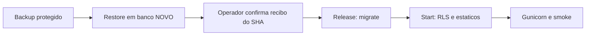

# Release explicito — contrato e ativacao pendente

Baseline: `3cfb35c3a2b89b00476f95b10222862bb57c9acb`. Implementacao para revisao; NAO ativada no Railway.

## Problema e contrato

Problema: migrate em cada boot mistura mudanca de schema e inicializacao. Usuario: operador da equipe. Hipotese: release explicito com gate reduz aplicacoes acidentais em restart. Evidencia: entrypoint anterior chamava migrate. Risco: promover sem configurar o release deixa banco atrasado. Metrica: zero chamadas a migrate no start/restart; release usa somente a URL de migrations. Validacao: testes de contrato mais ensaio real em banco descartavel, ainda pendente.



- `entrypoint.sh` apenas faz exec do comando; nao migra nem verifica tabelas antes do release.
- `sh scripts/release.sh` aplica migrations explicitamente. Funciona diretamente ou por meio do entrypoint.
- `sh scripts/start.sh SERVIDOR ...` verifica RLS com a credencial runtime, coleta estaticos e faz exec do servidor.
- Docker mantem Gunicorn, PORT, workers e timeout anteriores. Compose mantem runserver apenas no desenvolvimento, agora via start.
- collectstatic continua no start neste lote; mover ao build requer validacao propria. Nenhum storage ou middleware foi alterado.

## Gate de backup: confirmacao humana, nao prova automatica

Release exige `DATABASE_MIGRATION_URL`, `PM_BACKUP_REFERENCE`, `PM_BACKUP_FOR_RELEASE` e `PM_BACKUP_RESTORE_VERIFIED=true`. O candidato e `RAILWAY_GIT_COMMIT_SHA` quando disponivel; fora do Railway, e `PM_RELEASE_ID`. O recibo precisa corresponder exatamente ao candidato. Nao ha fallback para a URL runtime.

Essas variaveis sao atestacao do operador. O script NAO cria backup, nao testa restore, nao verifica um arquivo remoto e nao torna uma declaracao falsa impossivel. Nao preencher com valores ficticios, reutilizar recibo antigo ou tratar o gate como garantia criptografica. Nao colocar URL com senha no identificador do backup.

Antes de confirmar o recibo:

1. Registrar origem, versao real do PostgreSQL, SHA candidato, migrations aplicadas, operador e janela. Serializar releases; o script nao implementa lock distribuido.
2. Gerar backup completo com pg_dump compativel com o servidor, em destino restrito fora do conteiner efemero. Nao pressupor ferramentas PostgreSQL na imagem Python.
3. Registrar identificacao, integridade, horario e retencao; nao versionar dump nem dados pessoais.
4. Restaurar em banco NOVO descartavel, nunca sobre producao; conferir schema, dados preservados e permissoes previstas. Integridade de arquivo sozinha nao prova restauracao.
5. Registrar o resultado real e somente entao vincular a confirmacao ao SHA candidato. Definir tratamento de escritas concorrentes; rollback de dados nao pode ignorar alteracoes posteriores ao backup.
6. Registrar politica de objetos R2 separadamente: backup PostgreSQL nao inclui esses arquivos.

## Primeiro uso no desenvolvimento

Configurar `DATABASE_MIGRATION_URL` local e preparar/exportar o recibo real das quatro variaveis de release. Em banco novo, documentar a condicao vazia e o procedimento de recuperacao; nao desabilitar o gate no codigo para obter verde.

```sh
docker compose up -d database
docker compose run --rm --entrypoint sh \
  -e PM_RELEASE_ID -e PM_BACKUP_FOR_RELEASE \
  -e PM_BACKUP_REFERENCE -e PM_BACKUP_RESTORE_VERIFIED \
  django scripts/release.sh
docker compose up --build -d django status_api
```

Os valores precisam estar exportados no terminal local; o comando nao os inventa. Nao copiar configuracao de producao. Sem release anterior, o primeiro start pode falhar na verificacao RLS porque o schema ainda nao existe: executar release, nao reintroduzir migrate no boot. Comandos administrativos diretos passam pelo entrypoint sem tarefas extras.

## Ativacao Railway — requer autorizacao separada

1. Nao mergear/promover antes do ensaio descartavel e da revisao do operador. Suspender autodeploy para impedir promocao sem gate preparado.
2. Planejar o SHA efetivamente implantado, inclusive novo SHA de merge; recibo da ponta da branch nao vale automaticamente para outro SHA.
3. Preparar backup/restore e variaveis restritas do recibo. Configurar pre-deploy `sh scripts/release.sh` e conferir Start Command existente; override antigo pode contornar scripts/start.sh.
4. Confirmar uso da credencial runtime no start e da credencial de migrations no release, sem imprimir URLs ou segredos. Em producao manter PM_RLS_STRICT=true conforme configuracao aprovada.
5. Liberar deploy manual em janela controlada. Falha do pre-deploy deve bloquear promocao; nao repetir automaticamente sem avaliar estado do banco.
6. Testar porta, CSS/JS, saude, login e restart; confirmar em logs que restart nao migra. Nao marcar estes passos feitos pela existencia deste documento.

Railway executa pre-deploy em conteiner separado e nao persiste seus arquivos no conteiner web: https://docs.railway.com/deployments/pre-deploy-command

## Testes e limites

```sh
python -m unittest discover -s scripts/tests -p 'test_release_contract.py' -v
```

Os testes usam comandos simulados e nao conectam ao banco. Conferem bloqueios, roles, falhas, sintaxe shell, PORT/workers e reinicio sem migrate. O workflow existente passa a executa-los; nenhum resultado novo de CI e alegado aqui. Nao comprovam build Docker, Gunicorn real, Postgres, backup ou Railway.

Ainda pendentes: restore real; dois ensaios independentes de upgrade a partir do baseline anterior definido; smoke da imagem; CI verde no PR; verificacao do pre-deploy e do restart no ambiente autorizado. Preservar o label listaEspera e o historico. Exclusao antiga de lista de espera nao sera repetida em producao para produzir evidencia retrospectiva.

Rollback de imagem nao desfaz schema. Reverter ao codigo anterior tambem reintroduz migrate no boot: revisar o procedimento antes de reimplantar. Colunas aditivas 0026/0027 podem permanecer no rollback de codigo apos avaliar compatibilidade; reverter migrations pode apagar dados. Sem autorizacao, nao executar restore ou rollback em producao.

Saude sem metadados, Swagger/actuator, HTTPS, logging, alinhamento de versoes e restante da #115 permanecem em suas frentes. Este pacote nao declara resolver essas pendencias.
