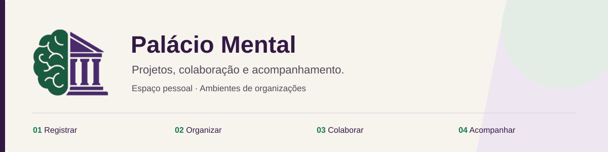

<p align="center">
  
</p>

<p align="center">
  <a href="../README.md">Projeto</a> ·
  <a href="https://go.postman.co/workspace/93cde965-fda5-4c07-b79b-7966778b859e">Workspace Postman</a> ·
  <a href="../.github/workflows/postman.yml">Automação</a>
</p>

## Jornadas de teste · CAMPPG

Execute as jornadas no **Postman web**. Os JSONs são cópias para revisão e recuperação.

| Jornada | Fluxo | Environment |
|---|---|---|
| 🏛️ Gestor e aluno | Criar programa e turma → formar grupo → criar projeto. | CAMP-PG · Gestor e aluno |
| 🗂️ Jornadas do MVP | Vincular projeto à turma → salvar contexto → verificar privacidade. | P.M · Jornadas do MVP |
| 🤝 Colaboração | Publicar → comentar e votar → solicitar e aceitar participação. | CAMP-PG · Colaboração |

## Executar

**Use contas de teste afiliadas ao CAMPPG.** As coleções criam e removem dados no ambiente real.

1. Em **Environments**, preencha os valores abaixo no ambiente correspondente. Use credenciais locais e senhas sensíveis.
2. Na coleção: **Run → Functional → Local**. Selecione environment e Desktop Agent.
3. Execute a coleção inteira, com **1 iteração** e **300 ms** entre requisições.

| Nos três ambientes | Valor |
|---|---|
| `tenant_a_base` | `https://camppg.palaciomental.com.br` |
| `allow_writes` | `true` |
| `approved_write_hosts` | `camppg.palaciomental.com.br` |

| Ambiente | Campos adicionais |
|---|---|
| Gestor e aluno | `gestor_username`, `gestor_password`, `aluno_username`, `aluno_password`, `professor_id` |
| Jornadas do MVP | `membro_username`, `membro_password`, `turma_id`, `orientador_id`; `grupo_id` opcional |
| Colaboração | `autor_username`, `autor_password`, `colab_username`, `colab_password`, `colab_display_name` |

Use **dois membros distintos** na colaboração. O aluno deve participar da turma. `turma_id`: UUID; `professor_id` e `orientador_id`: números.

<details>
<summary>Cobertura e resultados</summary>

- `allow_isolation=false` pula cinco passos de outro tenant. Pulados não contam como aprovados.
- Preserve `global_base` no domínio global: a consulta espera **404** para projetos institucionais.
- Convites por e-mail ficam fora desta suíte.
- Após falhas, confira os IDs criados e a limpeza.

</details>

## Executar pelo GitHub

Em **Actions → Postman · Jornadas do MVP → Run workflow**, selecione `main` e autorize os dados de teste. A execução manual roda as três coleções da web e publica resultados no Postman.

<details>
<summary>Credenciais da automação</summary>

Configure os secrets `POSTMAN_API_KEY` e `POSTMAN_TEST_ENV`. O segundo recebe um JSON com:

```text
gestor_username, gestor_password, aluno_username, aluno_password,
professor_id, turma_id, orientador_id,
colab_username, colab_password, colab_display_name
```

O aluno também atua como membro e autor. Atualize contas e IDs no secret. Environments temporários são removidos ao terminar.

</details>

## Manter atualizado

**Editar na web → validar → exportar → versionar.**

Exporte em **Collection v2.1** para os JSONs desta pasta. Mantenha credenciais vazias nos environments; não versione senhas, cookies ou tokens.

O CI manual usa a versão da web. Ao recriar uma coleção, atualize seu ID em [run_postman_cloud.py](../tools/run_postman_cloud.py). PRs e pushes testam apenas a automação local, sem acessar o CAMPPG.
