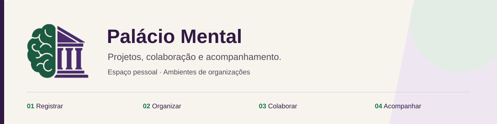

<p align="center">
  
</p>

<p align="center">
  <a href="../README.md">Projeto</a> ·
  <a href="http://localhost:8080/docs">Swagger local</a> ·
  <a href="../postman/README.md">Jornadas de teste</a> ·
  <a href="../.github/workflows/ci.yml">CI</a>
</p>

## Guardião de Contexto

API **Spring Boot / Java 21** para verificar links, monitorar páginas e registrar incidentes. O Django apresenta os resultados aos usuários.

| 🔗 Verificar links | 📊 Monitorar páginas | 🔔 Avisar sobre falhas |
|---|---|---|
| Ao receber alterações; depois, a cada **72 h**, com variação. | Consultas a cada **15 min**. | Discord, e-mail e caixa de entrada. |

**Django salva e enfileira → worker envia → Spring verifica → Django exibe.**

O recebimento é imediato; a verificação ocorre em segundo plano. Pendências permanecem na fila se a comunicação falhar.

## Executar e conferir

Após o [setup local](../README.md#executar), na raiz do projeto:

```sh
docker compose up --build -d
curl --fail http://localhost:8080/v1/ping
docker compose logs --tail=50 status_api guardiao_worker
```

Adicione um link a um projeto e confira o resultado na interface. `pong` confirma apenas que a API responde. O Compose prepara banco, migrations e worker; o token gerado no setup continua obrigatório.

| Acesso local | Uso |
|---|---|
| [Swagger · /docs](http://localhost:8080/docs) | Contratos e testes com token Bearer. |
| [Central · /status](http://localhost:8080/status) | Painel público; coleta automática exige produção e HTTPS. |
| `GET /v1/status` | Diagnóstico protegido do banco e Django. |

<details>
<summary>Testes automatizados e operações</summary>

O [CI](../.github/workflows/ci.yml) prepara banco descartável e valida migrations, isolamento e incidentes. Para executar com Java 21, use `./mvnw --batch-mode test` em `status_api/`. As integrações PostgreSQL exigem as variáveis e a preparação do workflow; sem elas, não há validação completa. A imagem runtime não contém Maven.

| Operação em `/v1/guardiao/links` | Finalidade |
|---|---|
| `POST` | Receber alteração. |
| `DELETE /{linkId}` | Remover link. |
| `POST /results` | Consultar resultados. |
| `POST /threats` | Avaliar ameaça. |

Corpos e respostas estão no Swagger. Para testar os fluxos Django: `docker compose exec django python manage.py test plataforma.tests.institucional`.

</details>

## Entender o painel

| Escopo | Páginas verificadas | Painel |
|---|---|---|
| Global | Início, vitrine, entrada e cadastro. | `/status` |
| Organização | Entrada institucional; sondagens opcionais. | `/status/org/{slug}` |

A consulta exige **HTTP 200 e conteúdo esperado**. O painel mostra última verificação e histórico de até 30 dias; isso não comprova todos os fluxos autenticados.

**2 falhas → incidente · 15 min de falha → destaque · 2 sucessos → recuperação.**

<details>
<summary>Sincronização de organizações e sondagens</summary>

O worker sincroniza domínio verificado e cores das organizações ativas. Sem atualização por dez minutos, o painel institucional deixa de publicar dados. Histórico e incidentes são separados por organização; os dados públicos ficam em `/v1/status/org/{slug}`.

A sondagem autenticada exige conta de membro dedicada, turma e registros de teste. Configure `PM_PROBE_USERNAME` e `PM_PROBE_PASSWORD` no executor:

```sh
python manage.py verificar_jornadas_institucionais   --origem https://tenant.homologacao.example.org   --projeto 42 --titulo-projeto "Projeto de teste"   --programa UUID_DO_PROGRAMA --nome-turma "Turma de teste"
```

Execute uma rodada por vez. O comando retorna JSON e código de erro em falhas. Mantenha resultados no próprio ambiente.

Para publicar: configure `STATUS_TENANT_PROBE_HOST` no Spring, o token compartilhado no executor e acrescente `--publicar-em https://api.exemplo.org/v1/guardiao/sondagens`. O hostname autorizado deve constar no snapshot recente. Há uma amostra por janela de cinco minutos, sem abertura automática de incidentes.

</details>

## Operar em produção

**Migrar → atualizar API e Django → iniciar worker → testar um link → ativar monitor e canais.**

<details>
<summary>Configuração essencial</summary>

| Onde | Variáveis |
|---|---|
| Spring · banco | `POSTGRES_HOST`, `POSTGRES_PORT`, `POSTGRES_DB`, `POSTGRES_USER`, `POSTGRES_PASSWORD`. Não lê `DATABASE_URL`. |
| Spring · Django | `DJANGO_APP_URL`: origem global HTTPS alcançável. |
| Spring, Django e worker | Mesmo `GUARDIAO_SERVICE_TOKEN` forte. |
| Worker | `STATUS_API_URL=https://api.exemplo.org/v1/status`; `GUARDIAO_API_URL` apenas para outro destino. |
| Spring · monitor | Perfil `production`, `STATUS_MONITOR_ENABLED=true`, após validar o núcleo. |
| Spring · Swagger | `SWAGGER_ENABLED=false`. |

Não use `guardiao-local`, `DEBUG` ou `GUARDIAO_LOCAL_HTTP` em produção. Preserve autenticação e proteção contra SSRF. Aceite cabeçalhos HTTPS apenas de proxies confiáveis, com estratégia nativa e `server.tomcat.remoteip.internal-proxies` restrito, bloqueando acesso direto com cabeçalhos forjados. Valide operações sem token (401) e com token pelo domínio HTTPS.

</details>

<details>
<summary>Migrations e worker</summary>

**Pre-deploy da API no Railway**, com timeout de 300 segundos:

```sh
java -jar app.jar --migrate-only
```

Configure `GUARDIAO_MIGRATION_JDBC_URL`, `GUARDIAO_MIGRATION_USER` e `GUARDIAO_MIGRATION_PASSWORD`. O executor confere o destino, aplica versões pendentes e valida o histórico; falhas impedem a troca da API.

Flyway cuida do schema `guardiao`, separado das migrations Django. O boot normal não migra. Preserve backup e migrations aplicadas; use role de migração própria. A role runtime precisa acessar tabelas e sequências, incluindo futuras, sem alterar o schema.

Execução manual: use o estágio Docker `migrate` ou `./mvnw --batch-mode flyway:migrate flyway:validate` em `status_api/`, com as variáveis acima.

**Worker:** imagem Django, processo supervisionado e sem domínio público. Substitua o entrypoint web por `python`, com argumentos:

```text
-u manage.py enviar_links_guardiao --continuo --intervalo 30
```

Não repita migrations web nem Gunicorn. Monitore a fila; cada pendência sai somente após confirmação. Em reversões, pare o worker, confira compatibilidade e preserve fila e tabelas.

</details>

<details>
<summary>Alertas e ameaças opcionais</summary>

| Canal | Variáveis no Spring | Critério |
|---|---|---|
| Discord | `STATUS_ALERT_DISCORD_WEBHOOK` | Abertura, prolongamento e recuperação. |
| E-mail | `STATUS_ALERT_EMAIL_TO`, `RESEND_API_KEY`, `DEFAULT_FROM_EMAIL` | Mais de uma hora de falha ou falha no Discord. |
| Inbox | Worker ativo | Mais de uma hora; contas ativas do escopo afetado. |

Entregas são persistidas, com até três tentativas. Sem canal, ficam pendentes. Discord pode duplicar mensagens; resposta inconclusiva aciona e-mail sem reenvio automático. Avisos de inbox expiram após 24 horas e têm deduplicação por evento/usuário. Teste cada canal com destinatários controlados.

**Safe Browsing:** configure `GUARDIAO_SAFE_BROWSING_KEY` somente no Spring. A consulta usa prefixos de hash e cache do provedor. Sem chave, em falhas ou URL não suportada: **não verificado**; salvar continua permitido com aviso. Ausência de detecção não garante segurança. O worker reavalia links e notifica ameaças ao autor. Confira cota e [termos de uso não comercial](https://developers.google.com/safe-browsing/terms).

</details>

<details>
<summary>Limites e compatibilidade</summary>

- A fila guarda o estado atual por link. Operações em massa que ignoram sinais Django devem enfileirar os IDs explicitamente.
- Primeira implantação da fila: pause gravações durante a migração; atualize a API antes do worker. O protocolo antigo de retratos é incompatível e pode deixar IDs obsoletos no Guardião.
- Worker: até 100 alterações por ciclo. Scheduler: um item por vez, pausa padrão de um segundo e limites por domínio.
- Snapshot: até 1.000 organizações e 1 MiB; demais operações: 64 KiB.
- Saúde atual considera última coleta e atualidade por tenant; agrupamentos históricos não determinam esse estado.
- Aplique todas as migrations pendentes: V9 retira incidentes legados sem inventar recuperação; V11/V12 acrescentam identificação pública e cores.

</details>
